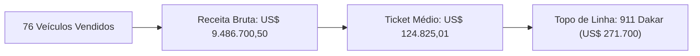

# Porsche Inteligência Executiva de Vendas | Painel Power BI

Este relatório executivo apresenta a análise consolidada das transações de vendas da marca **Porsche**, estruturado no padrão **Microsoft Power BI** com a identidade visual da marca (**Obsidian Black**, **Porsche Guards Red `#D5001C`**, **Porsche Crest Gold `#C5A059`** e **GT Silver**). Todas as informações, indicadores, métodos e status estão integralmente traduzidos para o **Português**.

---

## 📌 Acesso ao Dashboard Interativo em HTML

O dashboard interativo em HTML está disponível para navegação e consulta:
* **Arquivo HTML no Workspace:** [`index.html`](file:///C:/Users/Rapha/.gemini/antigravity/scratch/porsche_dashboard/index.html)
* **Visualização no Painel / Artefato:** [`porsche_sales_dashboard.html`](file:///C:/Users/Rapha/.gemini/antigravity/brain/fd466f2e-2ceb-4bfc-aa22-83a4bee347ea/porsche_sales_dashboard.html)
* **Diretório do Projeto:** [`porsche_dashboard`](file:///C:/Users/Rapha/.gemini/antigravity/scratch/porsche_dashboard)

> [!TIP]
> Abra o arquivo [`index.html`](file:///C:/Users/Rapha/.gemini/antigravity/scratch/porsche_dashboard/index.html) diretamente no seu navegador (Google Chrome, Microsoft Edge, etc.) para utilizar os segmentadores (*slicers*), filtros cruzados em tempo real, pesquisa dinâmica e exportação CSV.

---

## 💎 Indicadores Executivos (Topo do Painel)

| Indicador | Valor Consolidado | Detalhe Estratégico |
| :--- | :--- | :--- |
| **Total de Vendas** | **76 veículos** | 100% da base ativa de pedidos |
| **Receita Total** | **US\$ 9.486.700,50** | Volume bruto transacionado (~US\$ 9,49 Milhões) |
| **Ticket Médio** | **US\$ 124.825,01** | Preço médio por unidade comercializada |
| **Veículo de Maior Valor** | **US\$ 271.700,00** | Porsche 911 Dakar (Ano 2024, Pedido #105) |
| **Taxa de Concretização** | **47,4%** (36 unidades) | Status 'Entregue' (*Delivered*) com sucesso |

---

## 💳 1. Indicadores de Quantidade por Método de Pagamento

Todos os métodos de pagamento foram traduzidos e parametrizados por **quantidade física (volume)**, **participação percentual (%)** e **faturamento financeiro (US\$)**:

| # | Método de Pagamento | Quantidade de Vendas | % Participação | Receita Gerada (US\$) | Ticket Médio |
| :-: | :--- | :-: | :-: | :-: | :-: |
| 1 | **Transferência Wire** | **16** | **21,1%** | US\$ 2.395.700,00 | US\$ 149.731,25 |
| 2 | **Cartão de Crédito** | **12** | **15,8%** | US\$ 1.692.400,00 | US\$ 141.033,33 |
| 3 | **Leasing (Arrendamento)** | **10** | **13,2%** | US\$ 1.254.600,00 | US\$ 125.460,00 |
| 4 | **Dinheiro (À Vista)** | **10** | **13,2%** | US\$ 987.650,00 | US\$ 98.765,00 |
| 5 | **Transferência Bancária** | **8** | **10,5%** | US\$ 681.000,00 | US\$ 85.125,00 |
| 6 | **Financiamento** | **7** | **9,2%** | US\$ 622.950,00 | US\$ 88.992,86 |
| 7 | **Pagamento em Cripto** | **6** | **7,9%** | US\$ 1.083.000,00 | US\$ 180.500,00 |
| 8 | **Débito Direto (ACH)** | **4** | **5,3%** | US\$ 543.000,50 | US\$ 135.750,13 |
| 9 | **Cartão de Débito** | **3** | **3,9%** | US\$ 226.400,00 | US\$ 75.466,67 |
| **—** | **TOTAL CONSOLIDADO** | **76** | **100,0%** | **US\$ 9.486.700,50** | **US\$ 124.825,01** |

> [!NOTE]
> **Destaque:** A **Transferência Wire** lidera em volume (16 vendas) e em receita total (US\$ 2,4M). O **Pagamento em Cripto** possui o maior valor médio por veículo (US\$ 180.500,00), associado a modelos de altíssimo padrão como *Taycan Turbo S* e *911 Turbo S*.

---

## 🏙️ 2. Cidades com Maiores Quantidades de Vendas

A base geográfica compreende **49 cidades** em **23 estados americanos**. As praças com maior concentração de compradores são:

| # | Cidade | Estado (UF) | Quantidade de Vendas | Receita Gerada (US\$) | Principais Modelos Vendidos |
| :-: | :--- | :-: | :-: | :-: | :--- |
| **1º** | **Atlanta** | GA | **3** | US\$ 434.800,00 | 911 Carrera Cabriolet, Taycan Turbo, Taycan GTS |
| **2º** | **Seattle** | WA | **2** | US\$ 313.900,00 | 911 Turbo S, 718 Cayman |
| **3º** | **Dallas** | TX | **2** | US\$ 317.200,50 | Taycan Turbo (2 unidades) |
| **4º** | **San Jose** | CA | **2** | US\$ 216.500,00 | Panamera Turbo S, Cayenne |
| **5º** | **Charlotte** | NC | **2** | US\$ 215.300,00 | Taycan Cross Turismo, Cayenne E-Hybrid |
| **6º** | **Tulsa** | OK | **2** | US\$ 209.000,00 | Panamera, Panamera Turbo |
| **7º** | **Austin** | TX | **2** | US\$ 193.750,00 | Cayenne Coupe, Panamera |
| **8º** | **Orlando** | FL | **2** | US\$ 185.800,00 | Macan, 911 Carrera |
| **9º** | **Mesa** | AZ | **2** | US\$ 146.800,00 | Macan T (2 unidades) |
| **10º** | **Long Beach** | CA | **2** | US\$ 141.800,00 | 718 Cayman, 718 Boxster |

> [!IMPORTANT]
> **Destaques Regionais:** **Atlanta (GA)** é a única localidade com 3 veículos comercializados. As outras 9 praças do Top 10 possuem 2 vendas cada, e outras 39 cidades registram 1 venda. Por estado, o **Texas (TX)** lidera com 11 vendas (US\$ 1,49M), seguido pela **Califórnia (CA)** com 9 vendas (US\$ 1,26M) e **Flórida (FL)** com 6 vendas.

---

## 🏆 3. Top 10 Veículos Vendidos por Preço de Venda

Classificação individual dos 10 veículos de maior valor transacionados:

| Posição | ID | Modelo Porsche | Ano | Preço de Venda (US\$) | Localidade | Método de Pagamento | Status de Entrega |
| :-: | :-: | :--- | :-: | :-: | :--- | :--- | :--- |
| 🥇 **1º** | #105 | **911 Dakar** | 2024 | **US\$ 271.700,00** | New Orleans, LA | Leasing (Arrendamento) | Entregue |
| 🥈 **2º** | #60 | **911 Dakar** | 2024 | **US\$ 268.900,00** | Riverside, CA | Cartão de Crédito | Entregue |
| 🥉 **3º** | #92 | **911 Turbo S** | 2026 | **US\$ 249.300,00** | Boston, MA | Transferência Wire | Aguardando Entrega |
| **4º** | #77 | **911 Turbo S** | 2025 | **US\$ 242.000,00** | Lubbock, TX | Pagamento em Cripto | Aguardando Retirada |
| **5º** | #7 | **911 Turbo S** | 2024 | **US\$ 235.000,00** | Seattle, WA | Transferência Wire | Entregue |
| **6º** | #85 | **911 GT3** | 2024 | **US\$ 224.000,00** | Boise, ID | Transferência Wire | Aguardando Entrega |
| **7º** | #69 | **Taycan Turbo S** | 2025 | **US\$ 218.000,00** | Lincoln, NE | Transferência Wire | Pendente |
| **8º** | #35 | **Taycan Turbo S** | 2025 | **US\$ 214.000,00** | San Diego, CA | Pagamento em Cripto | Revisão Pendente |
| **9º** | #104 | **Cayenne Turbo GT** | 2025 | **US\$ 204.800,00** | Wichita, KS | Cartão de Crédito | Pendente |
| **10º** | #64 | **Cayenne Turbo GT** | 2025 | **US\$ 200.000,00** | Cincinnati, OH | Transferência Wire | Entregue |

---

## 🏎️ 4. Mix por Família Porsche

| Linha do Veículo | Quantidade | % do Volume | Faturamento Total (US\$) | % Faturamento | Modelos em Evidência |
| :--- | :-: | :-: | :-: | :-: | :--- |
| **Porsche 911** | **16** | 21,1% | **US\$ 2.693.350,00** | 28,4% | 911 Dakar, Turbo S, GT3, Carrera GTS |
| **Porsche Taycan** | **14** | 18,4% | **US\$ 2.169.500,50** | 22,9% | Taycan Turbo S, GTS, 4S, Cross Turismo |
| **Porsche Panamera** | **13** | 17,1% | **US\$ 1.378.450,00** | 14,5% | Panamera Turbo S, 4S, 4 E-Hybrid |
| **Porsche Macan** | **13** | 17,1% | **US\$ 1.011.650,00** | 10,7% | Macan GTS, Macan Electric, Macan T |
| **Porsche Cayenne** | **12** | 15,8% | **US\$ 1.507.050,00** | 15,9% | Cayenne Turbo GT, E-Hybrid, Coupe |
| **Porsche 718 (Boxster/Cayman)** | **8** | 10,5% | **US\$ 726.700,00** | 7,7% | 718 Cayman GT4 RS, Boxster GTS |
| **TOTAL** | **76** | **100,0%** | **US\$ 9.486.700,50** | **100,0%** | — |
